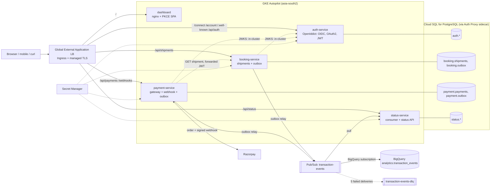
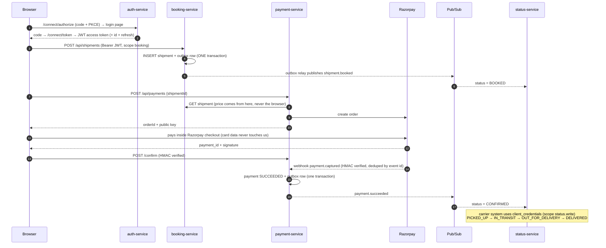

# Shipping POC: microservices on GKE (.NET 10 / .NET 8)

Login (OIDC + OAuth 2.0 + JWT), shipment booking, payments through a gateway (Razorpay), and event-driven
status updates. It is your Cloud Run diagram re-platformed onto **GKE Autopilot**, deployed from
**GitHub → Cloud Build → Artifact Registry → Helm → GKE**.

> **Read this first: nothing here has been compiled or deployed yet.** It was written without a .NET SDK, Helm
> or a GCP project to test against. Checked offline: JSON/YAML parse, shell syntax, bracket balance, and the
> Razorpay / Pub/Sub / NuGet details against current docs. Expect a few compile or chart errors on first
> build; see [First-run expectations](#first-run-expectations).

---

## 1. Architecture



### What changed versus your diagram

| Diagram | Here | Why |
|---|---|---|
| Cloud Run | GKE Autopilot, one Deployment per service, Helm chart | as requested |
| `transactions-service` | split into **booking-service** (shipments) and **payment-service** (gateway) | "booking" and "payment" are separate capabilities; each owns its tables and outbox |
| Pub/Sub **push** to status-service | **pull** (streaming) | Push needs a public HTTPS endpoint because Cloud Run scales to zero. GKE pods are long-lived, so pull keeps the consumer private. DLQ is unchanged. |
| status-service "internal only" | push consumer stays internal, but I **added a read API** (`/api/status`) and a carrier endpoint | the dashboard needs to show status and something must simulate carrier updates. Delete the `/api/status` path in `values.yaml` to hide it again. |
| `db-password`, `jwt-key` secrets | those two, plus `jwt-encryption-key`, `carrier-client-secret`, `razorpay-*` | OpenIddict needs a 2nd key; the payment gateway needs credentials |
| `jwt-key` → "all services" | only **auth-service** gets `jwt-key` | APIs validate tokens through the public JWKS, so they never need the signing key |
| "DB health ping (SELECT 1)" | `/healthz/ready` readiness probe on every service | same idea, uses Kubernetes probes |
| Cloud SQL (engine unspecified) | PostgreSQL 16, one schema per service | matches the `auth.*` / `txn.*` schema naming |

## 2. How it works



**Patterns used, and the problem each solves**

| Pattern | Problem it solves |
|---|---|
| Transactional **outbox** | Writing to the DB and publishing to Pub/Sub can't be one atomic step. Saving the event in the same DB transaction and relaying it afterwards means a booking never exists without its event, or the reverse. |
| **Idempotent consumers** (inbox table) | Pub/Sub and gateway webhooks deliver *at least once*. Duplicates are recognised by event id and ignored. |
| **Dead-letter topic** | A message that keeps failing is moved aside after 5 attempts instead of blocking the queue. |
| Server-side price | The browser sends only `shipmentId`. Amount comes from booking-service. |
| Two confirmation paths | Browser callback = fast UX; signed webhook = authoritative if the user closes the tab. |
| DB unique index on paid shipments | Even a bug can't record two successful payments for one shipment. |

**Security model**

* Users: OIDC authorization code + **PKCE** (no client secret in the browser), short-lived access JWT (30 min), refresh token (7 d).
* Machines: OAuth 2.0 **client_credentials** (`carrier-sim`, scope `status.write`). A user token gets `403` on that endpoint.
* APIs check signature (JWKS), issuer, audience (`booking-api`, `payment-api`, `status-api`) and **scope**.
* No keys in images or Git: Secret Manager + **Workload Identity**; one Google service account per service with only the access it needs.
* Pods run non-root, read-only filesystem, no privilege escalation; DB traffic goes through the Cloud SQL Auth Proxy.

## 3. Repository map

```
src/Contracts        event records + shipment status rules
src/Platform         shared: Secret Manager config, JWT validation, outbox relay, Pub/Sub, DB bootstrap, health
src/AuthService      OIDC server (OpenIddict) + Identity users + login UI
src/BookingService   shipments API
src/PaymentService   payments API, Razorpay/fake gateway, webhook
src/StatusService    Pub/Sub consumer, status read API, carrier endpoint
src/Dashboard        static SPA (PKCE) served by nginx
tests/Shipping.Tests pricing, signature, status-rule unit tests
deploy/helm/shipping chart: one template loops over all services
deploy/infra         setup.sh (one-time GCP), create-trigger.sh, teardown.sh
deploy/local         nginx config that mimics the load balancer locally
cloudbuild.yaml      push to main: test → build → push → helm deploy
requests.http        every API call, runnable from VS Code
```

## 4. Run locally in VS Code

Prerequisites: .NET SDK 10 (or 8), Docker, VS Code with the **C# Dev Kit** and **REST Client** extensions
(`.vscode/extensions.json` recommends them).

```bash
code .
docker compose up -d --wait postgres pubsub dashboard edge   # or run the VS Code task "infra: up"
```
Press **F5** and choose **"All services (F5)"** (auth 5001, booking 5002, payment 5003, status 5004), then open
**http://localhost:8080**: sign up, book a shipment, press **Pay**, and the status moves BOOKED → CONFIRMED.
(Locally the "fake" gateway asks you to confirm or cancel instead of opening Razorpay.)

Alternatives:
* No debugger: run the task **"run: all services (no debugger)"**.
* Everything in containers: `docker compose -f docker-compose.yml -f docker-compose.full.yml up --build`.
* No C# Dev Kit? Use the `dotnet watch run` tasks, or `dotnet run --project src/AuthService` in four terminals.
* API-only: open `requests.http` and send requests top to bottom (uses the dev-only password grant).

`http://localhost:8080` is served by nginx, which mimics the production load balancer with the same path map, so the
OIDC issuer and cookies behave as in the cloud.

## 5. Deploy to GKE from GitHub

**5.1 One-time GCP setup** (Cloud Shell is easiest; you need Owner or equivalent on a billing-enabled project):
```bash
export PROJECT_ID=your-project
./deploy/infra/setup.sh
```
Creates the Autopilot cluster, Cloud SQL, Artifact Registry, secrets, Pub/Sub (topic, DLQ, pull subscription,
BigQuery subscription), per-service Google service accounts with Workload Identity, a static IP and a Cloud Build
service account. It prints the IP and the Cloud SQL connection name. Re-running is safe.

**5.2 DNS:** create an `A` record for your host (e.g. `shipping.example.com`) → the printed static IP.
The host becomes the OIDC issuer, so decide it now.

**5.3 GitHub + Cloud Build** (one-time, needs a browser):
1. Push this repo to GitHub.
2. Console → **Cloud Build → Repositories (2nd gen) → Create host connection → GitHub**, authorise, then **Link repository**.
3. Create the triggers:
   ```bash
   PROJECT_ID=$PROJECT_ID HOST=shipping.example.com SQL_CONNECTION=<printed> \
   CONNECTION=<connection-name> REPOSITORY=<linked-repo-name> ./deploy/infra/create-trigger.sh
   ```
   (If gcloud rejects a flag on your version, check `gcloud builds triggers create github --help`; or create the
   triggers in the console with `cloudbuild.yaml` and the substitutions `_HOST`, `_SQL_CONNECTION`.)

**5.4 Ship it:** `git push origin main`. Cloud Build runs tests, builds the 5 images in parallel, pushes them, and runs
`helm upgrade --install --atomic`, so a failed rollout **rolls back automatically**. Pull requests run tests and
image builds only.

**5.5 Wait for the certificate:** `kubectl -n shipping get managedcertificate` must show `Active`. This takes 15 to 60 minutes
after DNS resolves, and until then HTTPS fails (that's normal). Then open `https://your-host`.

Triggered builds only: `SHORT_SHA` (the image tag) doesn't exist for manual `gcloud builds submit`.

## 6. Real payments with Razorpay

1. Create a Razorpay account and use **Test mode** keys first.
2. Store them: `echo -n 'rzp_test_xxx' | gcloud secrets versions add razorpay-key-id --data-file=-` (same for `razorpay-key-secret`).
3. Dashboard → Webhooks: URL `https://your-host/webhooks/razorpay`, events **payment.captured, payment.failed, order.paid**,
   choose a secret and store it in `razorpay-webhook-secret`.
4. Make sure payment **auto-capture** is enabled in your Razorpay settings (the code treats `payment.captured` as success).
5. Switch provider: set `_PAYMENTS_PROVIDER=razorpay` in the trigger, push, or `helm upgrade ... --set payments.provider=razorpay`.
   Pods read secrets at startup, so the deploy restarts them.

To add Stripe/PayU/Cashfree: implement `IPaymentGateway` (`src/PaymentService/Gateways.cs`) and register it in `Program.cs`.
Gateways differ in webhook headers and signature scheme, but the order → checkout → signed webhook shape is the same.

## 7. Try the whole thing (checklist)

- [ ] Sign up and sign in through the dashboard (redirects to `/account/login`, back with a code).
- [ ] Book a shipment → appears as **BOOKED** within ~2 s (outbox → Pub/Sub → status-service).
- [ ] Pay → **CONFIRMED**.
- [ ] `requests.http` #8/#9: carrier token (client_credentials) pushes **PICKED_UP**…**DELIVERED**; #10 returns 403 for a user token.
- [ ] Open `/.well-known/openid-configuration` and `/.well-known/jwks`.
- [ ] BigQuery: `SELECT * FROM analytics.transaction_events ORDER BY publish_time DESC` shows every event.
- [ ] DLQ: stop status-service, publish a bad message, watch it land in `transaction-events-dlq-sub` after 5 attempts.
- [ ] `kubectl rollout restart deploy/booking-service -n shipping` while clicking around: no errors (rolling update, `maxUnavailable: 0`).

## 8. Switching .NET 10 ↔ 8

One property: `DotNetMajor` in `Directory.Build.props` (default 10). Override with `dotnet build -p:DotNetMajor=8`,
Docker `--build-arg DOTNET_MAJOR=8`, or Cloud Build `_DOTNET_MAJOR=8`. Microsoft/EF/Npgsql package versions follow it
(`8.0.*` / `10.0.*`). .NET 10 is the safer default: **.NET 8 support ends in November 2026**.
NuGet versions are floating (`10.0.*`, `7.*`, `3.*`) for convenience. Once it builds, run
`dotnet restore --use-lock-file` and commit the lock files for reproducible builds.

## 9. POC shortcuts → production checklist

| Shortcut | For production |
|---|---|
| Tables created at startup (`EnsureDatabaseAsync`) | EF Core migrations run by a Helm pre-upgrade Job |
| Data Protection keys stored unencrypted in the DB | Encrypt with a Cloud KMS key |
| Secrets read once at startup | External Secrets / CSI driver + a reloader, or restart on rotation |
| Public Cloud SQL IP behind the proxy | Private IP only (`cloudSql.privateIp=true`), no authorised networks |
| Forwarded JWT between payment → booking | Client-credentials token with a dedicated scope |
| Ingress + Google-managed cert | Gateway API, Cloud Armor (WAF, rate limiting), restrict webhook source IPs |
| No rate limiting on signup/login | Cloud Armor + ASP.NET rate limiter; email verification; MFA |
| No refunds, partial payments, or cancellation | Refund flow; reconcile gateway settlements; alert on `DUPLICATE PAYMENT` log |
| `fake` gateway and password grant exist | Compile out / never enable in production (both are off by default in the chart) |
| No NetworkPolicies, single region | NetworkPolicies, Cloud SQL HA + read replica, multi-region plan |
| Logs only | Cloud Monitoring alerts on DLQ depth, outbox lag, 5xx; OpenTelemetry tracing |

## 10. First-run expectations

Where a first build is most likely to need a tweak:
1. **C# compile errors** (most likely in `AuthService`, the heaviest on third-party APIs). Run `dotnet build ShippingPoc.sln` and fix what it reports; OpenIddict and the Google client libraries move quickly.
2. **Helm**: run `helm lint deploy/helm/shipping --set gcp.projectId=x,image.registry=x,cloudSql.connectionName=x:y:z` and `helm template ...` before the first deploy.
3. **gcloud flags** in `setup.sh` / `create-trigger.sh` may differ slightly by version (the Pub/Sub BigQuery subscription and Cloud Build trigger flags especially).
4. The `deploy` step assumes the `cloud-sdk:latest` builder image includes `kubectl` and `gke-gcloud-auth-plugin`. If not, install them in that step.

## 11. Troubleshooting

| Symptom | Likely cause |
|---|---|
| Pods `CrashLoopBackOff`, log says secret access denied | Workload Identity binding missing: re-run `setup.sh`; check `kubectl describe sa auth-service -n shipping` shows the annotation |
| Pods never Ready | Cloud SQL proxy can't connect: check `kubectl logs <pod> -c cloud-sql-proxy`; confirm `cloudSql.connectionName` and the `roles/cloudsql.client` binding |
| `401` from APIs, log mentions issuer | `Auth__Authority` ≠ token issuer (scheme, host, trailing slash). They must come from the same host value |
| Login loops back to the login page | Cookie not sent: the issuer must be `https` in the cloud; wait for the certificate to be Active |
| Status stuck at PENDING | status-service can't pull: check the `roles/pubsub.subscriber` binding and `kubectl logs deploy/status-service` |
| Payment succeeded in Razorpay but not here | Webhook not reaching `/webhooks/razorpay` or wrong `razorpay-webhook-secret`; look for "invalid signature" in payment-service logs |
| Ingress `ADDRESS` empty for several minutes | Normal on first creation; check `kubectl describe ingress shipping -n shipping` |

## 12. Cost and cleanup

Autopilot bills for the pod resources requested (about 10 small pods here), plus Cloud SQL (`db-g1-small`), the load balancer
forwarding rule and the static IP. All of it is billed while it exists, even idle.
Delete everything with `PROJECT_ID=... ./deploy/infra/teardown.sh`.
